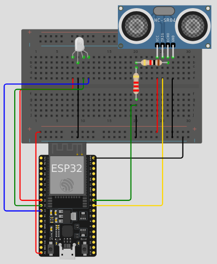

# Lixeira Inteligente - IoT (Projeto Herdado — Etapa 3)

> Fork do projeto **Lixeira Inteligente IoT**, de **Deusiane Pimenta Rocha** (turma 2026.1), remontado e melhorado por **Paulo Ribeiro** na disciplina de Internet das Coisas (2026.2) — IFMA, Campus São Luís Monte Castelo, Bacharelado em Sistemas de Informação. Professora: Salete Silva Farias.

## 📜 Créditos, licença e autorização

| Item | Informação |
| ---- | ---------- |
| Autora original | Deusiane Pimenta Rocha |
| Repositório original | <https://github.com/deusiii/deusiane-pimenta-lixeira-inteligente-iot> |
| Vídeo do circuito (projeto original) | [Link do vídeo](https://drive.google.com/file/d/1vz3ODsqVBXVFEM01nTiaUAWpsk-c5HjR/view?usp=sharing) |
| Licença | Sem licença declarada (todos os direitos reservados à autora) |
| Responsável por este fork | Paulo Ribeiro |

Como o repositório original não declara licença, todos os direitos pertencem à autora, e por isso a autorização foi solicitada antes de usar e modificar o projeto.

### Registro da autorização

| Campo | Registro |
| ----- | -------- |
| Quem autorizou | Deusiane Pimenta Rocha (autora do projeto) |
| Data | 03/11/2026, às 08:18 |
| Canal | WhatsApp (mensagem direta) |
| Pedido | Autorização para usar, modificar e publicar um fork do projeto de IoT, mantendo o crédito à sua autoria |
| Resposta | "Autorizo !" |


---

## 📌 Descrição do Problema

Na coleta de resíduos, as lixeiras costumam ser esvaziadas por rotina fixa: algumas transbordam antes da coleta e outras são visitadas ainda vazias.

A **Lixeira Inteligente IoT** monitora o nível de preenchimento sem que seja preciso abrir a tampa. Um sensor ultrassônico **HC-SR04** mede a distância entre a tampa e o lixo, o **ESP32** calcula o percentual de ocupação, um **LED RGB** mostra o estado no próprio local e a plataforma **ThingSpeak** permite o acompanhamento remoto, apoiando uma coleta sob demanda.

| Situação | Cor do LED |
| -------- | ---------- |
| Nível menor que 50 % | 🟢 Verde (vazia) |
| Nível de 50 % até menos de 80 % | 🔵 Azul (metade da capacidade) |
| Nível a partir de 80 % | 🔴 Vermelho (cheia) |
| Leitura inválida do sensor | 🟡 Amarelo piscando (erro de sensor) |

## 📡 Protocolo de Comunicação

O projeto usa **HTTP**, por meio da API REST do ThingSpeak (biblioteca `ThingSpeak.h`). O nível da lixeira, em %, é enviado ao **Field 1** do canal a cada 20 s.

**Justificativa:** o tráfego é pequeno, esporádico e em um único sentido (do dispositivo para a nuvem), sem comandos remotos. Nesse cenário, a conexão persistente e o *subscribe* do MQTT fariam pouca diferença, e o ThingSpeak já oferece armazenamento e gráficos prontos, sem broker ou dashboard próprios. A autora do projeto original também relatou instabilidade nos testes com MQTT.

**Limitação:** o envio é feito em HTTP sem TLS, portanto a Write API Key trafega em texto claro pela rede.

## 🧩 Componentes

| Componente | Especificação |
| ---------- | ------------- |
| ESP32 | Microcontrolador com Wi-Fi integrado (lógica de 3,3 V) |
| Sensor ultrassônico HC-SR04 | Alcance aproximado de 2 cm a 400 cm, alimentado em 5 V |
| LED RGB (cátodo comum) | Indicação visual do estado da lixeira |
| Resistor de 1 kΩ | Divisor de tensão do pino ECHO |
| Resistor de 2,2 kΩ | Divisor de tensão do pino ECHO |
| Jumpers | Conexões elétricas |
| Protoboard | Montagem sem solda |
| Cabo USB | Programação e alimentação do ESP32 |
| Balde (lixeira) | Estrutura física, com altura útil configurada de 30 cm |

## 🔌 Esquema de Ligação



O arquivo do circuito está em [`wokwi/diagram.json`](wokwi/diagram.json) e pode ser importado no Wokwi.

| HC-SR04 | ESP32 |
| ------- | ----- |
| VCC | 5V (Vin) |
| GND | GND |
| TRIG | GPIO 5 |
| ECHO | GPIO 18 **via divisor de tensão** (1 kΩ em série; 2,2 kΩ do GPIO 18 ao GND) |

| LED RGB (cátodo comum) | ESP32 |
| ---------------------- | ----- |
| R | GPIO 25 |
| G | GPIO 26 |
| B | GPIO 27 |
| Comum (-) | GND |

> ⚠️ Não ligue o ECHO direto no ESP32: o sensor devolve um pulso de 5 V e as GPIOs trabalham em 3,3 V.

## ⚙️ Instruções de Instalação e Uso

### Arquivos do repositório

| Arquivo | Conteúdo |
| ------- | -------- |
| [`codigo-fonte`](codigo-fonte) | Código-fonte comentado do ESP32 |
| [`secrets-example.h`](secrets-example.h) | Modelo do arquivo de credenciais |
| [`wokwi/diagram.json`](wokwi/diagram.json) | Circuito para o Wokwi |

### 1. Instalar as dependências

Na Arduino IDE:

* Instale o suporte à placa ESP32 (Gerenciador de Placas → *esp32 by Espressif Systems*).
* Instale a biblioteca **ThingSpeak** (by MathWorks) pelo Gerenciador de Bibliotecas.
* A biblioteca `WiFi.h` já vem com o pacote da placa ESP32.

### 2. Configurar o ThingSpeak

1. Crie uma conta em <https://thingspeak.mathworks.com>.
2. Crie um canal (*Channels → New Channel*) e habilite o **Field 1** (nível da lixeira, %).
3. Anote o **Channel ID** e a **Write API Key** (aba *API Keys*).

### 3. Preparar o projeto e as credenciais

1. Na Arduino IDE, crie um sketch chamado `lixeira` e substitua o conteúdo de `lixeira.ino` pelo conteúdo de [`codigo-fonte`](codigo-fonte).
2. Na mesma pasta do sketch, copie [`secrets-example.h`](secrets-example.h) com o nome **`secrets.h`**.
3. Preencha o `secrets.h` com os seus dados:

```cpp
#define WIFI_SSID              "SEU_WIFI"
#define WIFI_PASSWORD          "SUA_SENHA"

// Channel ID (número) e Write API Key (aba "API Keys" do canal)
#define THINGSPEAK_CHANNEL_ID  0000000UL
#define THINGSPEAK_WRITE_KEY   "SUA_WRITE_API_KEY"
```

> ⚠️ O `secrets.h` está no `.gitignore`. Nunca faça commit das suas credenciais reais.

Se a sua lixeira tiver outra altura útil, ajuste a constante `ALTURA_LIXEIRA` no código (padrão: 30 cm).

### 4. Enviar o código

1. Conecte o ESP32 ao computador.
2. Selecione a placa (*ESP32 Dev Module*) e a porta correta.
3. Compile e envie o código.

### 5. Usar

1. Instale o sensor na tampa, apontado para o interior da lixeira, e energize o ESP32.
2. Abra o Monitor Serial a **115200 baud** para acompanhar a distância, o nível, o estado do Wi-Fi e os envios.
3. Observe a cor do LED. A medição é atualizada a cada 1 s, mesmo sem Wi-Fi.
4. Com o Wi-Fi conectado, acompanhe o gráfico no ThingSpeak (envio a cada 20 s).

| Sintoma | O que verificar |
| ------- | --------------- |
| LED amarelo piscando | Ligações do sensor e do divisor de tensão; objeto a menos de 2 cm ou sem retorno de eco |
| `[WiFi] Tentando (re)conectar...` repetido | SSID e senha no `secrets.h`; sinal da rede |
| `[ThingSpeak] Erro ...` | Channel ID e Write API Key; intervalo entre envios de pelo menos 15 s |

## 📝 O que mudou em relação ao original

### Hardware

Foi adicionado um **divisor de tensão** (1 kΩ + 2,2 kΩ) no pino ECHO. Na montagem original ele era ligado direto ao GPIO 18, com risco de queimar o ESP32. Com o divisor, a tensão no pino é de `5 V × 2,2 / (1 + 2,2) ≈ 3,4 V`.

### Software

| Aspecto | Original | Agora |
| ------- | -------- | ----- |
| Leitura do sensor | `pulseIn` sem tratamento de falha | *Timeout* de 30 ms e descarte de leituras sem eco ou fora de 2–400 cm |
| Falha de leitura | Sem eco, o nível ia a 100 % (falso "cheia") | LED amarelo piscando e nível não enviado |
| Wi-Fi | Conexão só no início, travando até conectar | Não bloqueia na inicialização e tenta reconectar a cada 10 s |
| Funcionamento offline | Sem Wi-Fi ao ligar, o LED não acendia | Medição e LED funcionam sem Wi-Fi; só o envio é suspenso |
| Temporização | `delay(20000)` entre as medições | `millis()`: medição a cada 1 s e envio a cada 20 s |
| Credenciais | Escritas no código-fonte | Em `secrets.h`, ignorado pelo Git |

### Documentação

Foram incluídos o registro de autorização, o esquema de ligação no Wokwi e as instruções atualizadas de instalação e uso.

---

## 👩‍💻 Autoria

**Projeto original:** Deusiane Pimenta Rocha — estudante do 7º período de Sistemas de Informação, projeto desenvolvido para a disciplina de Internet das Coisas (IoT), 2026.1.

**Remontagem e melhorias (2026.2):** Paulo Ribeiro.
